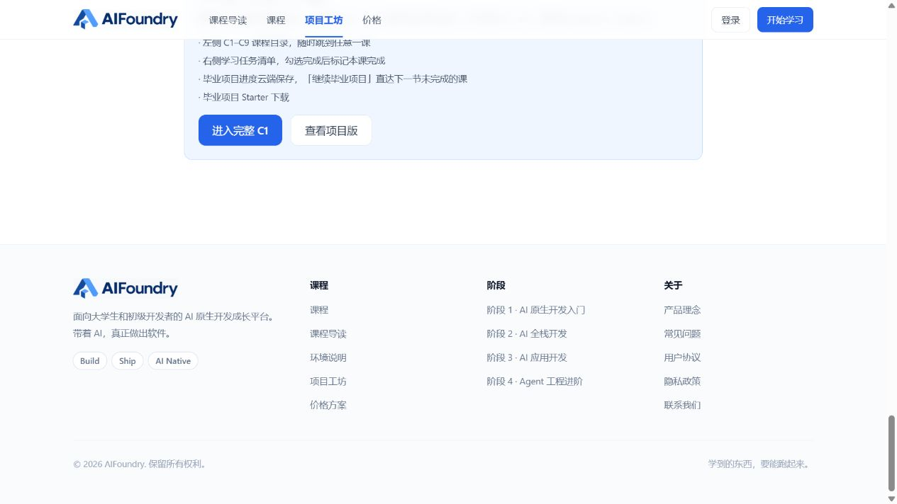

# 课程按钮审查 · 2026-10-11

全站 src TSX 静态扫描发现 8 个使用 .btn 但未指定 btn-sm / btn-md / btn-lg 的按钮，分布于 7 个文件。课程相关为 5 个按钮、3 个页面。计数为源码声明数量，不是运行时出现次数。

## 截图验证

1. 环境说明页 /environment：存在问题。「从第 0 课开始」实际高度 20px、padding 0px、字号 14px、圆角 8px。背景紧贴文字，点击区域过小。
   
2. C1 免费节选 /capstone/preview/c1：存在问题。「进入完整 C1」实际高度约 21.33px、padding 0px。旁边「查看项目版」同样遗漏尺寸。
   
3. 毕业项目课程错误状态：源码确认 2 个按钮遗漏尺寸；本次未进入登录后的错误状态，未截图验证。

## 全部遗漏

| 文件 | 行号 | 按钮 / 状态 |
| --- | --- | --- |
| src/pages/Environment.tsx | 68 | 从第 0 课开始 |
| src/pages/CapstonePreview.tsx | 25 | 进入完整 C1；查看项目版 |
| src/pages/CapstoneLessonPage.tsx | 18 | 返回项目工坊；查看项目版（错误状态） |
| src/auth/AuthProvider.tsx | 46 | 身份校验错误状态的重试 |
| src/pages/Home.tsx | 286 | 加载错误时重试 |
| src/pages/Pricing.tsx | 16 | 加载错误时重试 |

## 原因与建议

- src/index.css:67 的 .btn 只定义布局、字体、圆角、焦点等，没有默认尺寸。现有 sm/md/lg 为 36/40/44px；遗漏尺寸就退化到文字高度。
- 优先给 .btn 设置默认 40px 高度、左右 16px 内边距，让遗漏尺寸也能正常显示；保留显式 sm/md/lg 覆盖，核对生成 CSS 的覆盖顺序。普通操作沿用 40px，主要学习入口使用 44px，圆角沿用现有 8–10px。
- 环境说明页入口建议用 btn-lg，放在简洁的收尾区域中，加一句「环境准备好后，进入第 0 课完成检查」，让入口与下一步任务相连。
- C1 节选维持一个蓝色主按钮「进入完整 C1」，一个描边次按钮「查看项目版」；都使用明确尺寸，间距 12px，窄屏换行。
- 毕业项目错误页采用 flex flex-wrap gap-3 排列动作，替换 ml-3，避免换行后仍有左边距。
- src/index.css:81–85 的 primary/outline 悬停与按下使用 enabled:，生成的 :enabled 不匹配 Link 渲染的 a。建议改为兼容链接和按钮、同时排除 disabled 与 aria-disabled 的状态规则，并验证两类元素。
- 后续可收口为共用 Button/ButtonLink，默认 md，通过 size 与 variant 传参，避免反复拼接遗漏。先修公共尺寸和状态，不必重新设计全部课程按钮。

## 范围与限制

本次线上视觉验证为环境页、C1 免费节选页；其余计数来自源码。未验证所有登录态、错误态、键盘交互与手机断点，不代表完整无障碍审查。源代码里的常规课程导航、开始体验、下一课、完成任务按钮已显式指定尺寸，不计入这 8 处。课程正文资源下载按钮使用独立样式并有 10px/14px 内边距，也不是同一遗漏。

本次仅新增审查报告和截图，未修改产品代码。本地预览因缺少 Vite 依赖未启动，截图来自线上当前页面。

## 本地修复结果

后续按用户要求仅在本地修复：全部 8 个按钮补齐显式尺寸；公共 .btn 默认 40px 高度和 16px 水平内边距；primary/outline 状态兼容链接与按钮并排除禁用状态；环境页加入下一步提示、箭头和手机全宽入口；毕业项目错误提示使用可换行的按钮组。

类型检查与 Vite 前端构建通过（构建仍有主包体积提示）。重新扫描遗漏尺寸为 0。浏览器本地验证环境入口与 C1 节选入口均为 44px 高度、20px 水平内边距。未推送、部署或修改线上网站。

