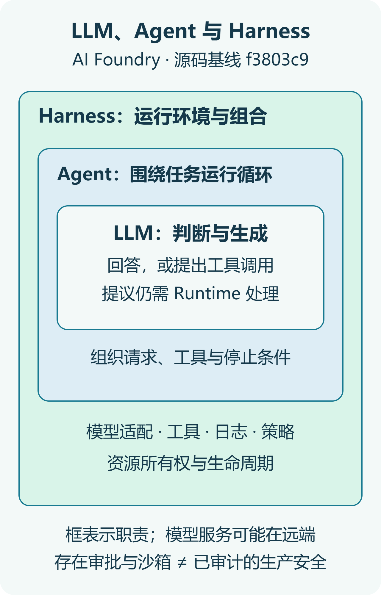
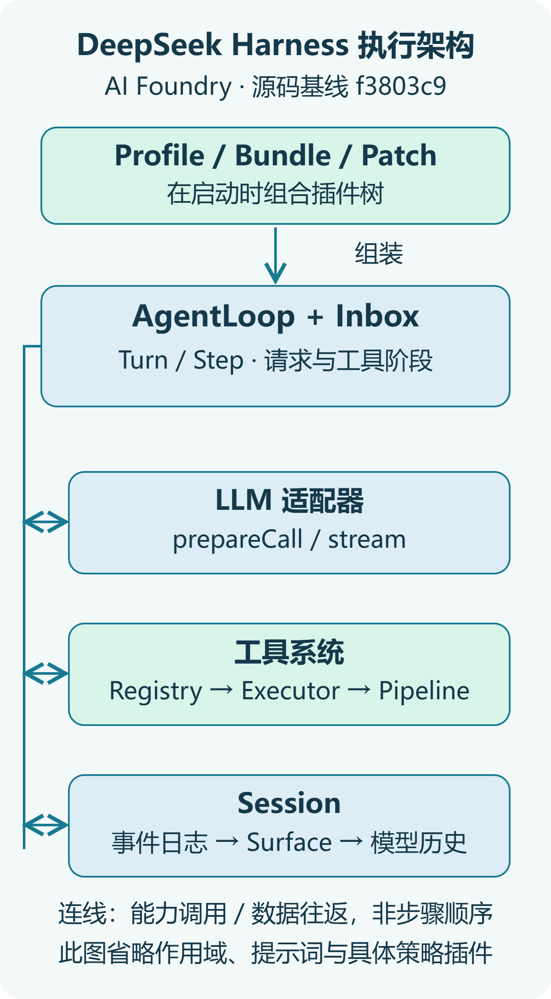
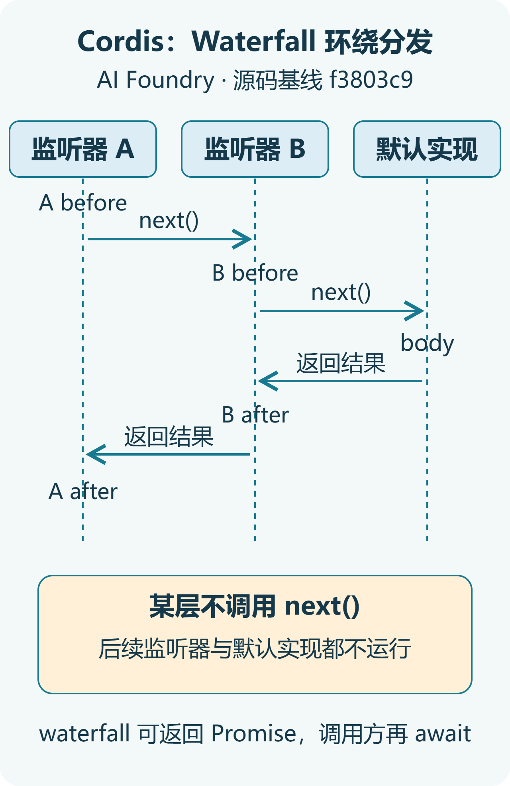
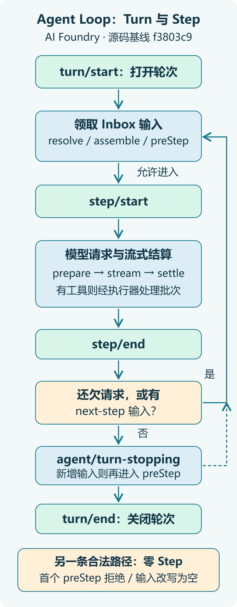

# 教学配图规划与视觉规范

共 56 张图，覆盖 30 讲；每讲 1–2 张，首批实制 4 张。其余明确为 PLANNED，没有占位图片嵌入。

## 视觉规范

延续现有 teaching-visual-v2 的浅青白背景、深蓝文字和青绿主线：背景 #F3F9F8，正文 #15394B，主线 #187A91，正常 #D9F4E9，待判定 #FFF0D7，错误 #FCE5E3。颜色同时配文字/线型，不能仅凭红绿识别。系统关系用容器/实线，事件通知用标注虚线，调用和返回需独立标注；所有箭头须被源码或明确的教学简化说明支持。

首批使用可编辑 SVG，由 scripts/draw_figures.py 确定性生成，scripts/render_figures.mjs 在本机 Chromium 渲染为 PNG。基础 viewBox 宽 640；主标签 32–34，说明 28，保持单列或短时序；移动端约 288px 内容宽时关键标签至少约 14px，辅助标签至少约 12px。最终 PNG 以 2 倍像素输出，320/390/1440 视口检查溢出、截断、中文字体和原图入口。图的高宽可随内容增加，不把复杂图挤成一张横幅。

图中模型、Loop、工具、持久事实用稳定文字标识。禁止机器人/科幻背景替代技术结构，禁止伪造真实软件截图。关系图是职责抽象；流程图必须说明省略了哪些异常/策略分支。新增复杂路径另拆图。

alt 描述信息与关系，caption 用一两句解释当前阅读重点；长图的全部可达分支还应在正文有文本等价说明。SVG 保留 title/desc；PNG 对应 alt/caption 记录在 figure-plan.json。每张图都记录代码来源 Commit 与引用编号；图形是本课程原创绘制，官方源码 MIT、第三方素材另核许可。首批无引用官方截图、字体文件或外部图片。

## Renderer V2 兼容核对

`src/components/LessonMarkdown.tsx` 已将 Markdown img 渲染为 lesson-figure，title 优先作为 caption，支持懒加载和“查看原图 ↗”。因此图示放大已有基础能力，无需本轮开发。`src/lib/lessonMarkdown.ts` 的 lessonUrl 只接受 `/course-media/` 与 HTTPS 图片；本地 docs 路径不会作为线上课程图片 src 生效。CSS 限制最大宽度并保持高宽比。

本轮实图保存在 **docs/deepseek-harness-v2/figures**，只在作者离线 QA server 中映射虚拟 `/course-media/harness-v2/` 路径。没有写 public。正式制课若判定为可公开的技术图，审查后才能复制到 public/course-media/harness-v2；受保护图、整课截图和答案不得放入该目录，需另提鉴权资源接口方案。未注册任何下载 asset。

未来标准嵌入写法（示例是约定，非声称已部署路径）：

```md

```

严格接口图优先 SVG/可控绘图；只有情境插画确有教学价值时才用图像生成，并记录人工核对。代码行高亮/行号目前没有专用能力：暂用短围栏+固定 GitHub 行链接。多面板响应式图可先拆图；内联 Mermaid 未集成时一律预渲染图片，不添加执行脚本。

## 完整图目录

| 图号 / 课时 | 类型与标题 | 教学目的 | 必含结构 | 状态 |
| --- | --- | --- | --- | --- |

| H01-01 | 关系对比《LLM、Agent 与 Harness》 | 区分提议、循环执行与工作台能力 | 三层职责；模型输出为提议；Runtime 受控执行；日志/策略/适配器为环境能力 | GENERATED_SAMPLE |

| H02-01 | 架构《源码导航地图》 | 围绕问题选包 | apps/CLI 入口；packages 两层域；vendor；tests；实线导入与虚线查找 | PLANNED |

| H03-01 | 架构《整体执行架构》 | 看清控制与持久事实两条线 | Profile/Bundle 组合；AgentLoop；LLM；Tools；Session；通知与写入分开 | GENERATED_SAMPLE |

| H03-02 | 时序《一次只读搜索》 | 串起一个请求 | 用户、loop、adapter、executor、Session；两次请求与一次工具结果 | PLANNED |

| H04-01 | 流程《启动与配置来源》 | 避免命令相同就误认为配置相同 | CLI 参数；Harness home；Profile；构建产物；sdk-minimal 例外 | PLANNED |

| H05-01 | 场景对照《写死依赖与服务契约》 | 建立注入直觉 | 写死 new provider；接口消费；Context key；inject 等待；类比边界 | PLANNED |

| H05-02 | 架构《Context 与 Service》 | 区分类型声明和运行时注册 | Context proxy；Service key；消费者；服务未挂载时等待 | PLANNED |

| H06-01 | 时序《Cordis 事件分发机制》 | 解释 next 的环绕与返回 | A before→B before→fallback→B after→A after；不 next 短路 | GENERATED_SAMPLE |

| H06-02 | 对比《五种分发模式》 | 选择等待与短路语义 | emit；parallel；serial；bail；waterfall；0 是 bail/false 不是 | PLANNED |

| H07-01 | 时序《插件挂载与依赖撤走》 | 揭示生命周期 | 依赖就绪；apply；effect；撤依赖；等待工作；dispose | PLANNED |

| H07-02 | 状态《资源归属与释放台账》 | 防止监听器与进程泄漏 | owner fiber；注册项；disposer；drain；scope；不假设全局逆序 | PLANNED |

| H08-01 | 层叠《Bundle 与 Patch 优先级》 | 手算最后配置 | 空树；有序 bundle；profile；home；overlay；整 config 替换 | PLANNED |

| H08-02 | 对比《全局、agent scope 与 isolate》 | 区分三种边界 | 服务 realm；agent 可见性；插件所有权；边界不等价 | PLANNED |

| H09-01 | 状态《Agent 发布事务》 | 解释半初始化回滚 | prepare；Session announce；setup/commit；Agent announce；失败 unwind | PLANNED |

| H09-02 | 所有权《调用者与 Factory》 | 防止推错 owner | caller fiber；factory 注册；unpublished handle；存储句柄；所有权箭头 | PLANNED |

| H10-01 | 流程《Agent Loop 的 Turn / Step》 | 推导零步与多步轮次 | turn/start；claim/preStep；拒绝或空输入零步；step；工具续步；turn-stopping；turn/end | GENERATED_SAMPLE |

| H10-02 | 对比《三种 Inbox 输入》 | 区分排队和唤醒 | followup/steer/inject；next-turn/next-step；wakeup；context 等待唤醒 | PLANNED |

| H11-01 | 流程《模型请求的准入与冻结》 | 明确真实输入版本 | selection snapshot；resolve/assemble；prepareCall；提交消息；header/context；freeze | PLANNED |

| H11-02 | 双轨《Prompt 与 Runtime Context》 | 区分刷新与重组 | system/message；runtime-context user/message；重试保持 assembly；刷新事实；新 series | PLANNED |

| H12-01 | 适配《统一流与 Provider 协议》 | 展示边界翻译 | GenerateOptions；adapter；SSE；StreamChunk；assembler | PLANNED |

| H12-02 | 状态《流式 Attempt 结算》 | 避免把 chunk 当持久事实 | start/chunk/end；assistant/message；assistant/attempt；硬退出前未结算 | PLANNED |

| H13-01 | 集合《作用域工具可见性》 | 手算 shadow/restrict | 全局、祖先、自有注册；限制交集；保留 run_code | PLANNED |

| H13-02 | 契约《Schema 到执行的固定集合》 | 防止描述与执行错配 | resolve；ResolvedToolSet；describe；prompt；executable；output schema | PLANNED |

| H14-01 | 流程《工具执行全流水线》 | 拆开准备执行结算 | tool/call；pre；ask；guard；around/body；project；post；finalize；tools/result；tool/result | PLANNED |

| H14-02 | 时序《正常、拒绝与结果改写》 | 辨认副作用发生时点 | body 是否运行；post block；observer throw 容纳；权威结果 | PLANNED |

| H15-01 | 决策《审批与单调守卫》 | 说明允许后仍会拒绝 | ask；无渠道拒绝；allowed-once；guard deny；body=0 | PLANNED |

| H15-02 | 边界《沙箱模式与实际强制执行》 | 避免生产安全过度承诺 | 三模式；confine/bypass；full/partial；网络不在定义范围；未审计 | PLANNED |

| H16-01 | 矩阵《四类能力三角色》 | 定位真实消费者 | fs/shell/web/MCP；definition/provider/consumer；同一 pipeline | PLANNED |

| H16-02 | 时序《MCP 工具接线》 | 区分发现与授权 | serverName；list；本地注册；call；SDK；结果投影；不可信数据 | PLANNED |

| H17-01 | 双轨《日志与模型可见 Surface》 | 解释事件溯源 | seq 事实日志；surface append/replace；deriveMessages；非消息事件 | PLANNED |

| H17-02 | 架构《Session Projection 注册与读取》 | 区分两类投影 | 纯 fold；registry handle；snapshot；message projection；不改原事件 | PLANNED |

| H18-01 | 对比《Replay、Resume 与 Fork》 | 避免重放副作用 | 重建视图；获取写句柄继续；复制固定前缀新身份 | PLANNED |

| H18-02 | 时序《写租约与中断尾修复》 | 明确恢复边界 | open(write)；lease conflict；未知工具结果；step/end；turn/end；generation | PLANNED |

| H19-01 | 对比《截断、剪枝与摘要压缩》 | 比较保留信息与成本 | 完整日志；tool pairing；prune；image offload；summary replace | PLANNED |

| H19-02 | 双轨《Compaction 的位置跨度》 | 理解 seq 非数值区间 | start/end position；shadowedSeqs；高 seq 摘要落旧位置；记账与替换分开 | PLANNED |

| H20-01 | 故障树《四阶段取消与恢复》 | 定位可撤销边界 | 准备前；stream 中；body 前；body 后；drain；unknown | PLANNED |

| H20-02 | 时序《同 Step 的模型重试》 | 避免重复用户消息 | attempt 失败；request-error；retry；不再 preStep/assemble；新 prepared call | PLANNED |

| H21-01 | 所有权《父子 Activation 树》 | 定位取消传播 | parent；local/external；delivery parent/caller；depth；dispose descendants | PLANNED |

| H21-02 | 对比《Spawn 与 Fork》 | 避免默认继承误解 | fresh context；seed prefix；历史 descriptor unknown；继续能力 | PLANNED |

| H22-01 | 矩阵《四种任务抽象》 | 防止把一切叫队列 | Workflow/Job/Goal/Schedule；触发、持有、结果、恢复 | PLANNED |

| H22-02 | 时序《编排与续跑的组合》 | 看清非线性关系 | PTC→subagent；Job 可晚于 turn；Goal round；Schedule delivery；phases 非 DAG | PLANNED |

| H23-01 | 架构《CLI、Web 与 SDK 载体》 | 识别共享能力和不同协议 | 统一 profile；controller；JSON-RPC；SessionProjection；live follow | PLANNED |

| H23-02 | 时序《断连重连与状态重建》 | 区分 snapshot 和增量 | subscription；revision；断连；snapshot；旧帧过滤；durable settlement | PLANNED |

| H24-01 | 测试图谱《证据层级与门禁》 | 避免覆盖率迷信 | unit/contract/property/replay/API/GUI/bench；skip 非 pass | PLANNED |

| H24-02 | 矩阵《核心架构风险审查》 | 完成跨模块综合判断 | 准入、所有权、持久、取消、未知副作用；事实与设计思考 | PLANNED |

| H25-01 | 生命周期《一个插件的验收闭环》 | 使实践可复验 | inject；register；execute/output；重复名拒绝；dispose 后不可见 | PLANNED |

| H26-01 | 矩阵《Provider 能力与默认值》 | 避免 API 表面兼容误判 | route；model；modalities；tool/system update；defaults；replay owner | PLANNED |

| H26-02 | 时序《Prepared Call 的一次性绑定》 | 保护真实请求封装 | prepare；freeze config；single dispatch；第二次/变 config 拒绝 | PLANNED |

| H27-01 | 时序《MCP Generation 与重连》 | 阻止迟到旧连接发布 | A old；B current；成功发现后替换；失败保留上一代；dispose | PLANNED |

| H27-02 | 架构《资源、工具与服务器指令》 | 区分三条接入路径 | shared resources provider；scoped tools；literal instructions；owner cleanup | PLANNED |

| H28-01 | 边界《启动、附加与共享桌面》 | 明确资源所有权差异 | launched 关闭；attached 断开；桌面不预留；不恢复登录态 | PLANNED |

| H28-02 | 流程《观察、操作、验证》 | 解释取消不能撤回输入 | fixture observation；grant；action；late cancellation；verify；禁止虚构真实截图 | PLANNED |

| H29-01 | 时序《延迟归因与缺失用量》 | 避免把未观测记为零 | 模型、工具、审批等待、flush；provider usage/估算/缺失 | PLANNED |

| H29-02 | 指标《评估与安全硬门槛》 | 避免平均掩盖失败 | 质量指标；拒绝/越权/重复写/取消；脱敏规则默认不自带 | PLANNED |

| H30-01 | 依赖图《Host / Client 构建图》 | 解释类型冲突与生成阶段 | two programs；Typert；references；host bundle；client bundle；gates | PLANNED |

| H30-02 | 流程《课程版本更新与证据失效》 | 把维护变成可执行流程 | 旧 commit→diff→受影响 H/图/实验→重核行号→复验→独立版本；不自动升级 | PLANNED |


## 首批成图与来源

四张图均由本目录脚本制作。PNG、SVG、alt、caption、Commit 与证据引用列于 figure-plan.json；实际几何/字体/视口检查结果与截图列于 figures/qa 和 evidence/visual-qa.json。结果只在脚本成功并经人工看图后才记 PASS。


### H01-01 LLM、Agent 与 Harness



[SVG 源文件](figures/source/h01-01.svg)；生成脚本 draw_figures.py / render_figures.mjs。来源编号：S001, S002, S003。

### H03-01 整体执行架构



[SVG 源文件](figures/source/h03-01.svg)；生成脚本 draw_figures.py / render_figures.mjs。来源编号：S007, S008, S002, S009。

### H06-01 Cordis 事件分发机制



[SVG 源文件](figures/source/h06-01.svg)；生成脚本 draw_figures.py / render_figures.mjs。来源编号：S017, S018, S019, S020。

### H10-01 Agent Loop 的 Turn / Step



[SVG 源文件](figures/source/h10-01.svg)；生成脚本 draw_figures.py / render_figures.mjs。来源编号：S030, S031, S008, S002。
