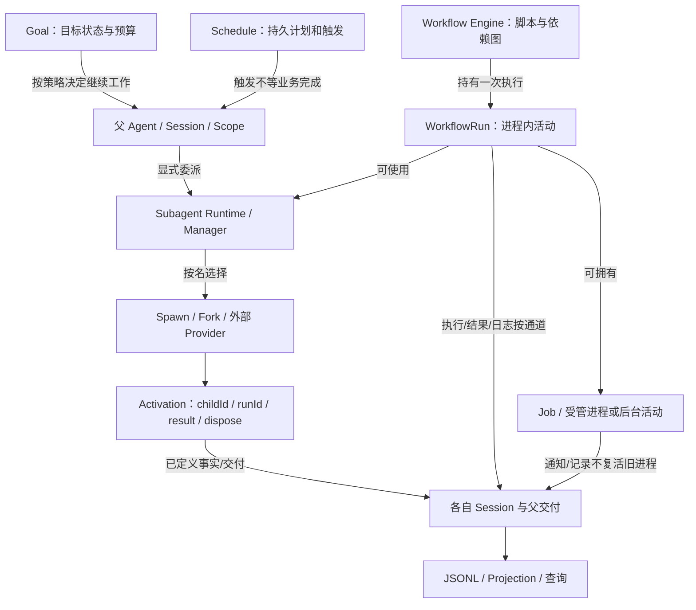

# 架构与所有权图（供审查）

下图是条件组合关系，非一条每次都走的调用链；来源为固定源码及H21/H22正文。未因画图而新增全模块动态证据。

Activation区分Parent/Caller，childId可跨执行期而runId更新；Fork继承已完成前缀而非未来。Workflow依赖边不是父子树；前台聚合等待不等异步Parent回执。Job/WorkflowRun不因读日志跨重启复活，Goal/Schedule的持久状态也不等所有外部效果已发生。取消责任沿显式持有关系传播，不能由关闭Client推出任意后台进程树已结束。

审查时分别画Registry owner、调用者和Session lineage；检查父取消、晚发布Activation和进程done/result/释放几个终点。只读图不能替代实际门闩/文件/进程证据。
