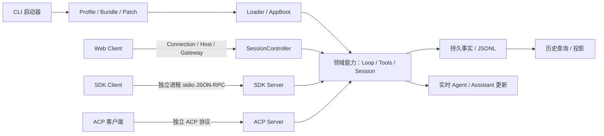

# 载体与完整运行链衔接

H23沿控制去程和状态回程取局部证据；H24加强真实作者YAML、HTTP故障及关闭后重建。CLI启动器不是TUI；SDK与Web协议、权限、身份机制独立，图中箭头不保证启用了同一套工具。

完整验收仍需实际已交付Profile与lib入口，Web真实浏览器和Host权限，ACP真实请求/语义事件等分别补验。H24只跑作者SDK/核心链，不把图上的全部节点标为已执行。默认SDK+HTTP退出P1在跨载体审查中必须先处理。
