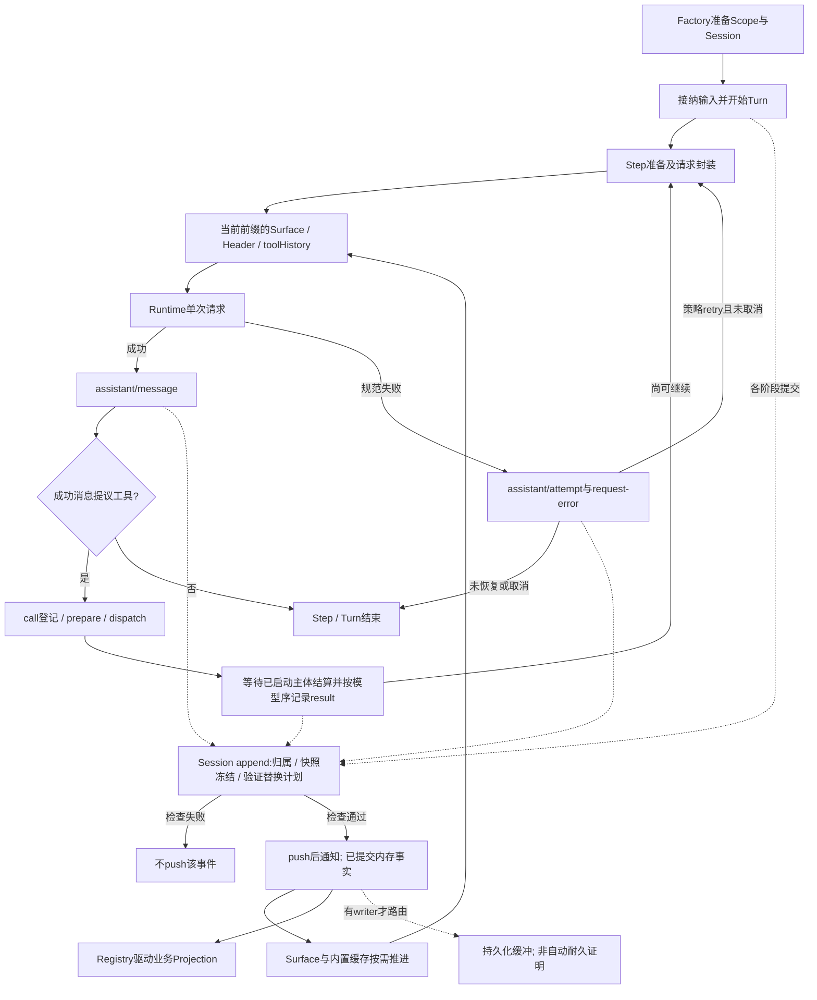
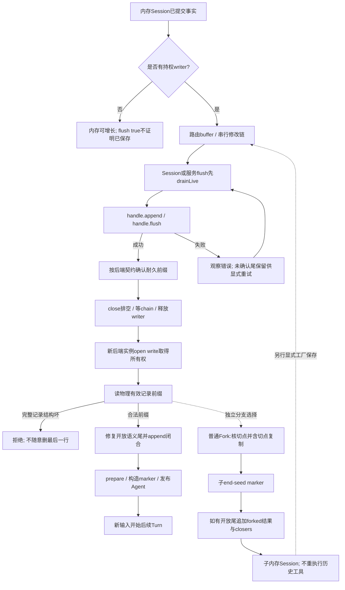
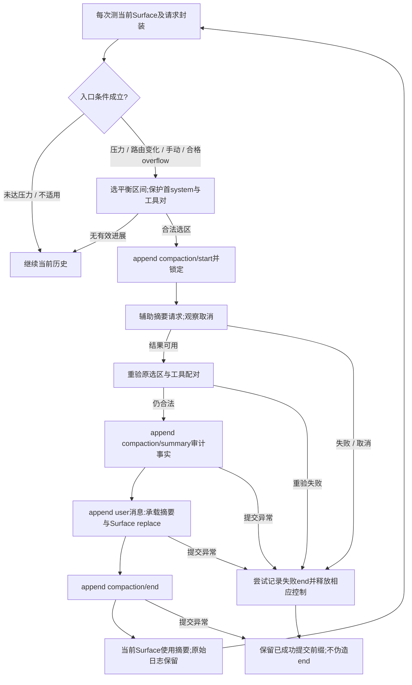
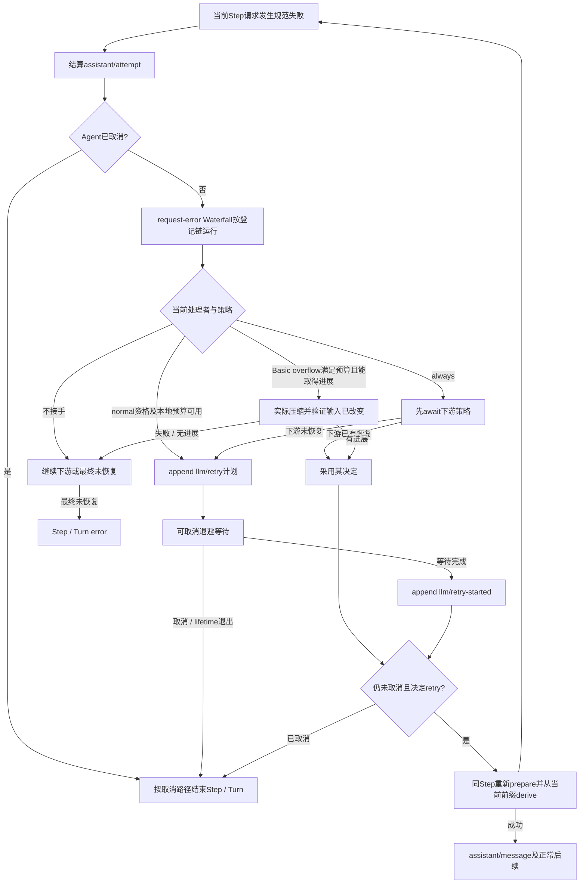

# 事件、保存、压缩与恢复流程图

以下图保留实际分支和回环，固定 `f3803c9`。它们表达源码条件与责任，不代表所有节点每次都执行；await之间可能并发收到取消、维护或新事件。新图的[SVG源文件](figures/source/)及[四图导出](figures/qa/module-diagrams-contact.png)提供纵向职责导航，不能把导航卡片的排列当作唯一时间顺序。源码范围见[断言索引](evidence/source-assertion-index.json)及专项报告。

## Event Log、读模型与Agent执行

只有五类合格消息来源按Surface读；retry、attempt、compaction/*等日志不会因为被append就进入普通请求。某个Projection观察器失败也不撤销已push事实。实际受控整链事件0–42见[统一模型](unified-reliability-model.md)。

## Persistence、Resume与普通Fork

图中Resume语义修复在构造marker前，普通Fork的marker在子合成closer前，顺序不同。JSONL实现的批次write+sync比通用append承诺更强。物理尾的处理取决于raw/Zstd和读取/首次写入阶段；不是一律删尾。外部工具效果不沿箭头回滚。

## Compaction的日志与Surface双层

T=`floor(min(W×ratio,W−O−B))`，保留目标R=`floor((W−O)×retainRatio)`，另受配置合法性/选区条件约束。summary和end本身不是模型摘要；替换也可能已成功而end未成功，不能称全部原子回滚。下一请求必须重新derive，不复用压缩前消息数组。

## Retry、Waterfall与取消

N→A只在下一Attempt也失败时发生。normal与Basic各自预算，注册顺序决定谁先接手，不能画成固定“先重试N次再压缩M次”。计划事件与started都没有通用自动flush保证；旧日志不能重建已消失的退避timer。工具批次取消的独立轨迹及未动态验证的物理sync竞态见[取消专项](cancel-and-side-effects.md)。
