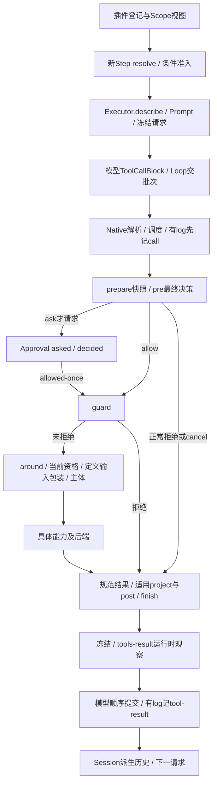

# H13–H16统一工具能力执行模型

固定Commit `f3803c96974ad4a94195fb97e5c637e9c2a3afe3`。以下选定**真实AgentLoop + NativeToolExecutor**主线；PTC只静态核描述，不拿Native证据替PTC执行。依据为[218项逐条索引](source-assertion-index.md)、[源码范围/哈希](evidence/source-review.json)、H13/H14/H16原程序与本轮[跨课夹具](lab/cross.test.ts)。用户的16步是检查表，实际顺序必须如下拆解，尤其输入Schema不提前到pre之前。

| 站点 | 实际拥有者/动作 | 必需或条件 | 产物与事实属性 |
|---|---|---|---|
| 1 | 插件构造ToolDefinition；defineTool编译DSL并创建输入校验包装 | 工具存在所需；不要求所有定义都经defineTool | 同进程函数、输出契约、声明；不发模型 |
| 2 | ToolsService.register，经ScopedLayers.effect登记定义/when | 注册插件依赖须满足 | 层和Fiber拥有的一次注册身份；不是Session事件 |
| 3 | 当前Scope view：继承、过滤交集、局部同名遮蔽 | 根与局部规则不同 | restrict过滤继承含祖先；自身登记最后叠加；非OS权限 |
| 4 | Loop preStep捕获modelSelection，tools.resolve逐项await when | 每新Step；重试不重做 | true纳入、false排除；throw/取消失败，不交部分集；条件须协作取消 |
| 5 | ResolvedToolSet绑定精确Agent对象及注册记录 | 本Step持有，finally释放 | 普通条件翻转不重算；每次读仍核当前Scope/原登记/未dispose |
| 6 | SystemPrompt组装时，ToolsService贡献工具provider，选择Executor.describe | 需有执行器；不是Registry自己选调用 | Native投影原始ToolSchema；PTC run_code + Prompt内SDK；输出Schema不随Native原始投影发送 |
| 7 | assemble→pre-step接纳→prepareCall能力绑定→project/提交→buildRequest/derive/freeze | H11的准备条件继续适用 | Loop请求与Adapter实收输入可能经Runtime能力投影不同；每次分别保存 |
| 8 | LLM流组装并结算assistant/message，取其ToolCallBlock[] | 成功工具响应；半截块不提前运行 | id/name/arguments字符串是提议；不是主体已执行 |
| 9 | AgentLoop调用ctx.tools.execute，ToolsService按Scope选执行器并委托整批 | 附agent、signal、toolSet、log turn/step、并行上限 | ToolBatchInput不是单项ToolExecutionInput；有Agent不自动有log |
| 10 | Native→executeToolBatch，计划/parseArguments | 此主线 | JSON.parse；空文本{}；坏JSON保留字符串供后续诊断，不一定入口throw |
| 11 | 分类/有界滚动补位，settlement.start | 仅精确true是parallel，独占屏障 | 启动项有log时先tool/call；这发生在prepare前，尚不证明作者主体开始 |
| 12 | pipeline.prepare物化分离参数、深冻结arguments，铸造token与exec | 无损物化可提前形成final-result | exec身份TS readonly，但pre时全对象未必冻结；最终观察前才冻结exec |
| 13 | tools/pre-execute Waterfall取得最终allow/deny/ask/cancel | 未挂监听时默认allow | 普通外层能改写内层deny；可信插件必须await/return next并遵守一次委托 |
| 14 | 最终ask→serviceAsk→ApprovalService.request | 仅ask；需有效Agent/Turn与服务；无渠道失败关闭 | asked→decided使用新审批ID；allowed-once才转allow；其他不授权；取消可先于迟到应答结算 |
| 15 | 最终allow后checkGuards | 有登记guard才实际检查；可拒绝/不表态 | 拒绝不进入around/body；批准后仍会被拒绝；不隔离恶意同进程代码 |
| 16 | dispatch→tools/execute环绕→dispatchToolBody再核当前定义/资格 | 允许且未被取消 | defineTool输入校验在这里的包装内部；校验通过才进入作者业务主体 |
| 17 | 具体Consumer调用能力Service/Provider/SDK | 依实际家族及插件组合 | File取意图/策略/目标；Shell取模式并confine/subprocess；Web选择Provider；MCP调用保留rawName的SDK闭包；不是通用Pipeline自动串四家族 |
| 18 | 后端实施实际约束与操作 | 各边界可选且不同 | fs-sandbox围栏、后端expected版本；进程sandbox的full/partial；Web目标控制另管；MCP Server本身有外部信任边界 |
| 19 | 成功规范JSON快照/输出校验/冻结→render/meta；普通业务错归一化 | body/定义的输出路径 | value/content/meta分开；普通Error不保证有统一机器code；exitCode7可为Shell正常描述值 |
| 20 | complete按post-result走projectContent→post；final-result跳过这两项 | 标签决定，不是所有失败走同一路 | 改content留value/meta；改value重验重投影；block去成功值/meta/主体上下文；不是副作用回滚 |
| 21 | finish候选物化→finalizeContent至多一次→最终物化冻结→tools/result观察 | 有定义才可有其finalizer；batch skip例外 | tools/result是运行时权威结果通知，观察失败被额外容纳；不等于Session已接受 |
| 22 | commitReady按模型连续前缀complete/commit；BatchSettlement提交 | 主体完成可乱序；根日志需agent+log | tool/result保存关联ToolResultMessage、error投影/meta等，不全量持久化规范value；additionalContexts另收集 |
| 23 | Loop接纳next-step上下文，下一新Step重新准入并从Session派生请求；释放旧set | concluded与队列共同决定续步 | 请求读到工具消息。内存append≠磁盘flush；新Session不恢复FS WeakMap、进程或连接 |

这张表不把先前的准备期事件说成工具Session事实。ToolCallBlock.id、exec.callId、Session tool/call.data.callId与tool/result.data.message.toolCallId对应一次调用；ApprovalRequestId是另一个身份，不按callId缓存授权。运行时错误为`result.error.info.code`，Session错误投影在`event.data.error.code`，不能混抄路径。

图中使用`tools-result`/`tool-result`只是Mermaid节点标签缩写，准确API名始终为`tools/result`与`tool/result`。异常的final-result与批次skip详见下表，不能从图省略推断全路径必经。

| 失败/取消位置 | 主体与后置 | 日志/续步 |
|---|---|---|
| pre正常deny、guard正常deny | 主体0，post-result仍可project/post/finalize | 有log形成错误工具消息；普通失败可有下一请求 |
| pre/guard/around自身throw | 可能未启动或已进入外层；final-result跳project/post | finish/观察后按正常提交；已发生效果不倒退 |
| defineTool参数错误 | 包装运行、作者主体0，错误仍post | 不能称prepare已经校验Schema |
| body抛错/坏输出 | 主体可能已经产生效果 | 普通错误结果保留其他项，未必终止Turn |
| 批次开始前已取消、尚未启动skip | 不进该项Pipeline，无tools/result | 有log可合成call/result保持配对；不制造主体轨迹 |
| 已开始策略/body/post不配合取消 | 等待实际Promise结算，成功可转取消 | signal不提供强杀/回滚保证；资源退出须drain |
| 调度/提交内部失败 | 停止补位并drain；partial仅已提交 | Loop修复有call无result为OUTCOME_UNKNOWN；未记启动为NOT_STARTED；可无对应call，不能盲重发 |
| concludeTurn成功标记 | 本批剩余项仍结算 | 无新材料可结束；nextStep上下文仍可带来续步 |

新增A把站点6–23中的批准后拒绝接到真实Loop；B把站点17–18与新鲜度和下一请求接通；C把步骤4和站点17的Web可用性分开。D直接复验H16真实SDK stdio与多家族Loop。`cross-*.json`同时保留每次事件前缀、Loop输入、Adapter输入、运行时观察与完整Session；另一个真实Session逐次重建messages/config/tools/toolHistory。它们是局部D，未接完整Profile、磁盘恢复或真实模型。
