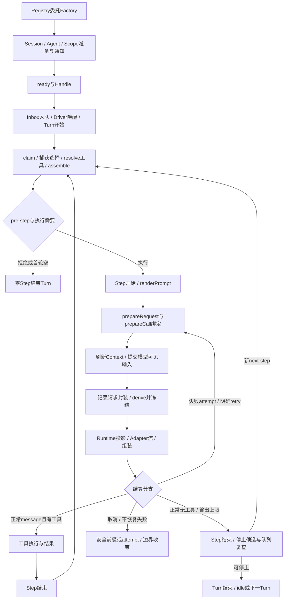

# H09–H12统一执行模型

固定官方Commit `f3803c96974ad4a94195fb97e5c637e9c2a3afe3`。本模型选择默认AgentLoop、新建无seed、已注册受控Adapter、正常内存Session这条主线。自定义Factory、直接一次性LLM调用、恢复和中间件短路各有不同入口，不能当成每次都必经的单链。

先用同一任务定位四课：H09让助手存在并明确退出责任；H10决定它何时进行下一次判断；H11决定每次判断带哪些材料；H12让返回的碎片成为可追踪的消息或失败记录。任务是“概括固定README”，工具仅返回代码内常量。

图例：**R**实时运行对象/状态；**S**Session已接纳事实；**M**模型调用边界；**T**工具执行边界；**C**控制流判断；**J**教学省略。S不等于后端flush。标签可重叠，不用颜色代替语义。

| 站点 | 实际顺序与状态/提交边界 | 失败或例外 | 固定源码 |
|---|---|---|---|
| 01 R/C | `AgentRegistry.create(options)`取得访问方ownerCtx，委托注册Factory.createAgent | 缺Factory拒绝；Registry本身不驱动模型 | agent/index.ts 401–440 |
| 02 R/C | 默认AgentLoop先sessions.prepare新Session，取得可选存储写句柄；进入initializeAgent | 同id冲突、后端失败、取消可能在发布前拒绝；resume先open(write)/read/修尾/prepare | agent-loop/index.ts 717–836 |
| 03 R | 安装调用方/工厂/创建取消联系与清理台账，构造ReactLoopAgent及Scope | Scope按loopCtx构造；parentAgent不隐含Scope父链；失败按已取得资源清理 | index.ts 478–594 |
| 04 R/S | 初始化维护内补存储后缀；Session enter→同步session/created→允许live append；await setup→同步commit | 创建通知不是Session日志事件；同步Session通知失败可否决；setup时Session可见、Agent未登记 | index.ts 615–636；session/index.ts 1287–1317 |
| 05 R/C | agents.enter(agent,parentAgent)→await serial agent/created→ready→退出维护→创建Promise兑现Handle | get可在通知结束前查到；有排队唤醒时，不能保证调用方拿Handle的首行先于Turn | index.ts 637–658；agent.ts 199–251 |
| 06 R/S/C | 用户followup入next-turn并唤醒；steer入next-step并唤醒；inject入next-step但不唤醒。splice事实先写 | 已aborted活动上会唤醒的输入转next-turn；原队列不是普通模型历史 | agent.ts 170–197；inbox.ts 97–112 |
| 07 R/S/C | idle先占running，kick→turn；检查signal后append turn/start，Turn编号加一 | turn/start前已取消不保证新增Turn结束事实；maintenance公开仍idle | agent.ts 230–342 |
| 08 R/S/C | preStep先claim：所有next-step，再按target取一个next-turn；捕获model.current选择 | claim记录splice并发claimed实时通知；领取不等于user/message接纳；拒绝不自动退回 | agent.ts 283–309；inbox.ts 104–112 |
| 09 R/C | await tools.resolve，得到该候选toolSet；带同一toolSet await systemPrompt.assemble | resolve失败/assemble失败仍无正式Step；模型选择固定于候选，不由request钩子换路由 | agent.ts 287–317 |
| 10 R/C | assemble求变量、工具Schema、段、Context，排序并经过展示Waterfall；再执行agent/pre-step | 默认pre-step渲染Context候选；可reject或改写输入。reject→blocked零Step；首个enter空→completed零Step | system-prompt/index.ts 619–693；agent.ts 297–359 |
| 11 S/C | 需要执行且检查取消后append step/start；进入step，**先renderPrompt一次** | Section插值失败可有Step但零模型调用；正式Step不保证请求已发生 | agent.ts 361–370、435–443 |
| 12 R/C | 尝试循环：prepareRequest→agent/request Waterfall→配置约束→await llm.prepareCall | prepareCall捕获注册代次/Adapter内部准备、校验能力、物化默认；NO_ADAPTER有中间件路线兼容；其他准备错误不走流后retry | agent.ts 613–652；llm/index.ts 960–1017 |
| 13 R/C | 成功准备后refreshContext→renderContextSections→project动态快照→取消检查 | 不重跑Section/Variable/tools/assemble Waterfall；刷新不再传候选toolSet。变量可仍旧值、Context已新值 | agent.ts 445–455；system-prompt/index.ts 587–607 |
| 14 S | SystemPromptProjection返回操作，Loop显式append system/message；firstAttempt接纳普通用户输入，并按当前值接纳runtime-context user快照 | 系统文本未变可不新增；初次空文本预留节点但不投影system消息；重试不重复用户，Context可更新 | agent.ts 452–478；runtime-context.ts 93–114、151–167 |
| 15 S/R | buildRequest按需append request/header、工具变更developer/message、request/context；deriveMessages取有效Surface消息；冻结header/消息/数组/请求 | 请求不是把全部Session事件直接发出；signal与sessionId是调用关联，非重建一个仍活着的AbortController | agent.ts 656–744 |
| 16 M/R | prepared.stream(request)或llm.stream(request)→llm/stream Waterfall→Runtime最终Adapter边界 | Loop输入不可改写。独立一次性调用可有GenerateOptions.system且无Session；其稳定输入由调用方保证 | llm/index.ts 999–1017、1063–1195 |
| 17 M/R | Runtime按能力投影文件/图片/工具更新、过滤不属于目标Adapter的私有Replay，再调用已绑定Adapter；Adapter产生StreamChunk | **Loop冻结输入与Adapter实际输入是两处边界**。有投影时值可不同；不能用冻结断言“每个对象恒等”。本轮无图片/文件工具更新模式专项 | llm/index.ts 1026–1041、1103–1134 |
| 18 R | 外层流句柄取得并检查取消后live.start；每片先检查signal，Accumulator分离冻结快照→Assembler.push→live chunk | start可早于第一片；运行时错误可被规范为failure finish；中间件错误/关闭错误另有throw边界；无通用协议校正 | agent.ts 487–502；assistant-stream.ts 49–71 |
| 19 S/R/C | 流消费结束：正常blocks→createAssistantMessage→settle append assistant/message→committed end(eventType,seq) | usage与compact stream嵌在结算事实，不是逐chunk事件。append失败→abandoned；实时文字不能替代提交 | agent.ts 572–587；assistant-stream.ts 78–108 |
| 20 S/R/C | error/aborted finish且本地未取消：先settle assistant/attempt→request-error决策→检查取消→仅retry时continue同Step | 失败草稿不进正常Assistant历史。重试重新prepare/刷新/派生，不重新preStep/组装；不再接纳普通用户 | agent.ts 535–571 |
| 21 S/R/C | 本地signal取消进入流catch：非空白text/reasoning安全前缀→interrupted message；否则attempt；重抛使Turn aborted | 工具块全部省略；已start但一般throw可记attempt；开始前throw可能无start/Assistant事实；结算失败不伪造committed | agent.ts 503–534；assembler.ts 162–179 |
| 22 T/S/C | 正常message已结算后：max-tokens直接返回停止候选；无工具→completed；有工具→await tools.execute，同一toolSet | max-tokens先去掉所有工具块，包括闭合合法工具。工具提议不等于授权；工具系统记录call/result；普通批次返回null，concluded可完成 | agent.ts 587–609；assembler.ts 135–149 |
| 23 S/R/C | Step finally写step/end、释放候选toolSet。普通工具反馈继续preStep；有停止候选且next-step空才通知turn-stopping，await后再查 | 已有max-tokens候选不会被后续completed降级；Step失败先尝试补缺tool/result，不代表重做副作用 | agent.ts 363–404 |
| 24 S/R/C | finally写turn/end。正常尾部有待办则重置信号/Step进入下一Turn，否则回idle | 拒绝/空输入早退或异常不承诺耗尽所有队列；whenIdle跟随活动收敛，非任务成功回执 | agent.ts 405–433、253–280 |
| 25 R/C | 必要时cancel仅请求停止活动；Handle.dispose共享记忆化teardown：等待通知和工作→Scope→可选write.close→Agent退出→Session退出 | 同id旧句柄不能删除新entry；不删除历史，不自动回滚外部效果；各等待段失败仍尝试后续清理，再报告 | index.ts 495–559 |

上表短路径均相对`packages/core/`，`llm/`相对`packages/llm/llm/src/`；同名agent.ts始终指`agent-loop/src/agent.ts`。完整可点击固定引用见[source-review.md](source-review.md)和逐条[source-check.json](evidence/source-check.json)。

此图是**J教学压缩**：省略每次signal检查、append失败、工具恢复、准备NO_ADAPTER兼容以及所有权退出，不允许从未画出的边推断它不存在。表格与真实轨迹优先于图。Handle返回后才发送任务是本轮A/B/C的输入安排，非任意创建监听器下的全局先后保证。

八项不变式的限定：A限公开API纪律，不能当恶意插件隔离；B以真实Turn/Step边界计数，可零Step、同Step多请求；C限Loop已构造的模型输入，重建messages/config/tools/toolHistory需相关事件前缀与相应投影代码，非恢复旧signal/真实HTTP或任意直接调用；Dassembly/系统文本/Context/Schema四种值分开；E准备捕获能力及注册项，但动态Adapter须捕获内部代次；Fchunk/块/message三层；Gcommitted需成功接纳事实，非flush，abandoned不可补造seq；H失败/取消分阶段，不保证正常message或自动retry。C的本轮可执行证据在五个跨课用例的loopRequests中。
