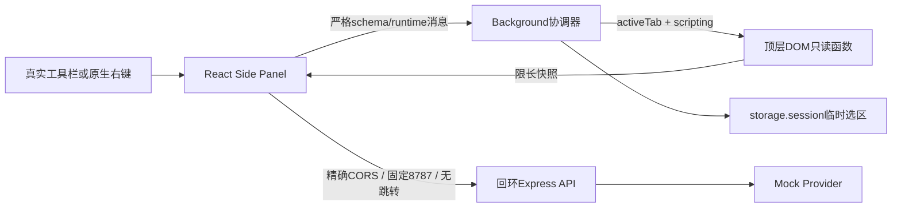

# Phase 0 架构与权限决策：第二轮收尾

日期：2026-10-14（Asia/Shanghai）。结论仍NO-GO；保留原技术路线，不进入P1–P8。首轮原文见 [decisions-round1.md](decisions-round1.md)。

## 0.0.2修正：普通worker休眠不代表页面变化

0.0.1的内存contextToken在worker休眠重启后丢失，误拒绝用户未变化网页的快照。现在以storage.session保存匿名代次UUID，工作进程重建时恢复；真实导航仍立即切换lease并串行持久化，旧请求仍拒绝。只有浏览器/扩展会话重置、真实上下文变化或TTL到期才要求重选/重读，不再一律使worker恢复前的选区失效。撤回先前“worker重启后随机代次应拒绝所有session遗留数据”的要求。

44项测试及真实Chrome worker终止/唤醒对照夹具已PASS；用户随后已确认原生侧栏Mock和45秒空闲后再次调用成功；跨源/右键/重启等仍待验证，保持NO-GO。详见evidence.md最新修复节与worker-lifecycle-fix证据。

## 0.0.1修正：普通action与自动Side Panel action不可混同

旧版openPanelOnActionClick=true在Chrome155的原生测试中不能取得activeTab。已核对[同版本Chromium源码](https://chromium.googlesource.com/chromium/src/+/155.0.8059.41/chrome/browser/extensions/extension_action_runner.cc)，自动侧栏分支在grant之前返回。现改为false + chrome.action.onClicked同步sidePanel.open；不增加权限。此前“工具栏图标打开侧栏即可授权”的表述必须限定为普通action回调路径，自动侧栏切换不适用。

37项测试及真实Chrome启动配置已通过；用户随后提交0.0.1原生读取成功截图，SP-03已PASS。跨源撤权、右键、Mock和重启仍需复验。详细失败、源码和包证据见evidence.md第0节。此修正属于Phase0原型，不发布课程。

## 保留的架构

WXT0.21.4、React18.3.1、TypeScript5.9.3、Express5.2.1、Zod4.6.5及独立lockfile均保留。主站Node20.19下限不适用于该WXT；本次实测Node24.16.0/npm11.13.0。依赖许可证及首轮审计记录不变，见artifacts/dependency-licenses.json、npm-audit.json；新ci也报告0个已知漏洞，不等同于完整安全证明。

## 本机API最小权限：由真实Chrome网络证据确定

**当前方案新增host权限为0。** 不是因为activeTab授予了localhost权限，而是API明确允许实际扩展Origin，扩展按标准CORS发JSON请求。Chrome155.0.8059.41的独立无界面Profile中，实际构建的worker与扩展文档均完成200往返，记录OPTIONS/POST和精确Origin，见 [Chrome验证](artifacts/round2/chrome-verified/chrome-network-probe.json)。文档测试为独立扩展标签页，不冒充原生Side Panel。

manifest继续只申请activeTab/scripting/sidePanel/contextMenus/storage，CSP `connect-src http://127.0.0.1:8787`，无host_permissions。共享fetch客户端固定URL、redirect:error、credentials:omit；服务端精确Origin/Host、JSON类型/schema/body、预检方法与header、速率/超时/Provider输出均检查。浏览器绕过CORS不是本方案所需能力，不为此提前增加权限。

如其他版本/企业策略下失败，先记录请求与错误，不能直接添加全站权限或放行空Origin。若将来采用host特权网络，必须重新验明实际Origin是否省略、最窄来源与本机请求凭据。现行官方match-pattern文档描述了显式port语法；Chrome155测试manifest接受`http://127.0.0.1:8787/*`，但本轮只测试了**解析接受**，未测试其全部权限匹配语义，未将其加入实际包。首轮“host match不能限制端口”的绝对表述撤回，以当前文档和具体浏览器证据为准。

本机回环绑定不等于用户鉴权，Origin也不能阻止恶意本地进程伪造header。本轮只Mock，不公开部署、不读真实Key。Chrome116和不同本地网络访问策略的原生侧栏行为仍需验证。

## 消息与临时授权

保留用户点击action/原生右键授予activeTab的设计。Panel按钮不产生新grant，也没有申请额外站点权限的代码。无需`tabs`永久读取权限，无法取得未授权URL时提示重新点图标。真实Chrome负例确认无grant的HTTPS tab注入被权限错误拒绝；正例grant生命周期仍待人工。

现有架构没有常驻Content Script。被注入函数只是读取顶层DOM并返回结构化文本，不监听网页消息、不读取Key、不调用API。runtime只接受本扩展精确sidepanel路径，拒绝`sender.tab`、外扩展/网页、额外字段；deterministic测试对此作边界检查，不能代替真实浏览器发送者语义实测。

将原background逻辑提取到`extension/src/coordinator.ts`以注入Chrome适配器进行确定性测试，入口仍负责注册真实Chrome事件。本轮修复：

- 请求开始前记录随机contextToken；onActivated/onUpdated loading或URL变化使其失效，能识别A→B→A及同URL刷新，而不只比较最终字符串。
- 0.0.2将代次存入storage.session，普通worker重启恢复同一页面代次；真正导航使其失效。它是上下文身份，不是密钥或付费授权。
- Panel在模型请求前后以CHECK_CONTEXT确认快照，所有异步context查询完成后重新检查generation，防止在await期间切页再切回。
- 按window串行化选区get/remove/set，避免并发消费；最新右键事件胜出。createdAt取原生事件处理开头，拒绝age<0或>=60000；空/超长/子框架选区覆盖旧内容并报错。
- 无关后台tab导航不清空当前选区。页提取格式错误与无权限错误分别反馈。

代次依赖真实Chrome导航事件，因此真实事件时序、SPA、worker休眠、面板冷启动仍是人工闸门；不声称已经穷尽所有导航竞态。

## 交付边界

只新增了安全修复、测试、故障夹具、验收文档；无正式课、P1–P8 Reference、笔记/问答/平台迁移。最小snapshot增加contextToken，不冻结为蓝图最终blocks契约。summary路由仍为Phase0演示接口，正式接口迁移留在获准后的后续阶段。

重建、网络测试默认写新的证据目录，避免覆盖第一轮证据；Vitest只收集tests目录，排除.runtime旧工程副本。无文件或目录批量删除。

## 官方核对来源

核对日期2026-10-14。官方文字/示例许可证记录沿用首轮；以下是设计依据，不冒充实测。

- [Chrome跨源请求](https://developer.chrome.com/docs/extensions/develop/concepts/network-requests)：无host特权时按跨源请求处理；host权限提供扩展跨源访问特权；content scripts仍受网页来源约束。
- [声明权限](https://developer.chrome.com/docs/extensions/develop/concepts/declare-permissions)：权限类型及host权限的能力。
- [Match patterns](https://developer.chrome.com/docs/extensions/develop/concepts/match-patterns)：回环IP与端口模式；本轮解析探针见上述JSON。
- [activeTab](https://developer.chrome.com/docs/extensions/develop/concepts/activeTab)：显式用户交互与临时grant。
- [scripting](https://developer.chrome.com/docs/extensions/reference/api/scripting)：动态注入的权限边界。
- [本地网络访问](https://developer.chrome.com/blog/local-network-access)：Chrome142起的站点本地网络提示背景；本文不从站点策略推断所有扩展版本行为。
- [WXT入口](https://wxt.dev/guide/essentials/entrypoints)、[Side Panel](https://developer.chrome.com/docs/extensions/reference/api/sidePanel)：继续沿用真实入口与用户手势要求。
