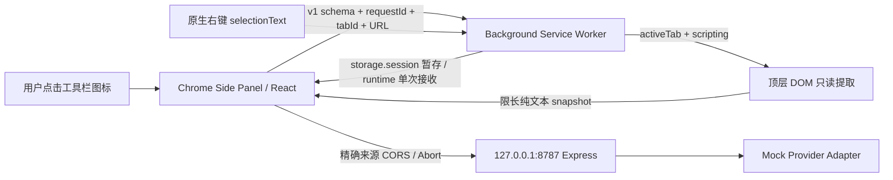

# Phase 0 技术决策与架构

日期：2026-10-14（Asia/Shanghai）。状态：**Spike 架构已实现，浏览器关键闸门未通过；不得进入 P1–P8。**

## 1. 与实际仓库的关系

已阅读根 README、package.json、course-content/README.md、docs/lesson-renderer-v2.md、docs/architecture.md、Capstone internal README，并检查 src/data/capstoneLessons.ts、server/routes/capstone.ts 和 Prisma 中的 Capstone 进度模型。当前仍是 29 节 Stage 正式课 + C1–C9；Capstone metadata 有独立 published 标记，正文受后端控制，进度模型按 Capstone 组织。internal README 中“只存在 C1/C2”等历史说明已落后于当前 metadata，未来接入应以实际文件与回归结果为准。

主仓库要求 Node 20.19+，采用 React 18 / Express 5；新 WXT 与其 Node 下限不一致。本 Spike 采用自己的 package.json/lockfile/tsconfig，放在 `spikes/ai-browser-copilot-spike`，不从主 src/server 导入，也未改根 package.json、授权路由、数据库、课程或发布标记。工作区已有平台修改，未重置、暂存或提交它们。

## 2. 本次确定的最小架构

这是当前实现架构，**并非已通过全部运行验证的最终课程架构**。WXT 构建、ZIP、服务端 HTTP 边界已通过；action→Side Panel、activeTab→注入、右键归属和 Panel→API 尚未通过真实交互。不得把官方 API 可用性推断成工程实测成功。

### 权限与消息

- 使用真实 WXT sidepanel/background 入口，产物分别是 `sidepanel.html` / `background.js`，MV3，无 `default_popup`。
- `sidePanel.setPanelBehavior({openPanelOnActionClick:true})` 在 worker 启动及安装/浏览器启动时设置。不能依赖只在热开发时设置一次。
- `activeTab` 由工具栏/原生右键手势授予；Panel 的按钮只复用已有授权。无 `tabs` 权限，未授权页面 URL 可能不可见，显示重新授权提示。注入失败也提示授权，不静默扩权。
- Schema 对请求、响应、选区与 API 两端执行严格验证；只接受本扩展 `sidepanel.html` 发来的内部消息，拒绝来自 content script/tab 的请求；没有 `externally_connectable` 或网页 `window.postMessage` 桥。
- 读取前后核对 active tab 和 URL，返回带 requestId/snapshotId；Panel 使用任务 generation 丢弃切页后的响应。完整文档 ID / 同 URL 重载竞态仍是后续复验重点，纯函数测试不能证明无竞态。
- 右键 handler 先同步调用 `sidePanel.open`，然后执行异步存储，避免 await 使用户手势丢失。`storage.session` 保存待消费选区应对面板冷启动，消费时复查 tab/URL/时间；不把 worker 内存当持久队列。未实现正式笔记。
- 排除 `chrome://`、Web Store 等页。页面和模型文本始终按 React 文本渲染，不执行文本或注入 HTML。只读取顶层、跳过表单/隐藏/脚本，限 6000 字符；长文抽取质量仍待实测。

### 模型与网络

- Express 独立绑定回环；只有 `/health` 与 `/api/ai/summary`。无 URL 抓取代理、真实 Provider、用户系统或公网服务。
- Origin 是启动时精确配置的 `chrome-extension://ID`；空/任意网站 Origin 均拒绝，Host 按回环名称 + 实际监听端口检查。限制 64KiB body / 6000 字符正文 / 30 请求每分钟，Provider 1.8 秒、Panel 2.5 秒超时。
- 无 host_permissions，尝试由精确 CORS 支持 Panel fetch；CSP 仅允许回环 API。**是否足够仍待 Chrome 实测，不能冻结为教材。** 如 Chrome 网络策略拒绝，先取证，再试最窄 `http://127.0.0.1/*` 网络授权，并检查浏览器是否省略 Origin；如省略，需重新设计经过实测的本地请求凭据/来源校验，不能直接允许无 Origin。
- Chrome host match 不能按示意图保证只访问一个端口；若采用回环 host 权限，应在代码中固定 8787，并把权限边界写清楚。来源校验不能防本机恶意进程，公网服务需要另行鉴权与配额。
- Provider 接口仅在服务端。当前输出 schema 的 provider 固定 `mock`，未来新增真模型时显式扩展 schema 并验证一致性。本轮没有费用调用，也没有读取主仓库 `.env`。

## 3. 实际依赖与可复现性

| 项目 | 实测/锁定版本 | 许可证 |
|---|---|---|
| Node / npm | 24.16.0 / 11.13.0 | Node/npm 各自发行条款 |
| 已安装 Chrome | 155.0.8059.41 | Google Chrome 条款，未重分发 |
| WXT / React module | 0.21.4 / 1.2.2 | MIT |
| React / React DOM | 18.3.1 | MIT |
| TypeScript | 5.9.3 | Apache-2.0 |
| Vite（传递依赖）| 8.3.4 | MIT |
| Vitest | 5.0.4 | MIT |
| Express | 5.2.1 | MIT |
| Zod | 4.6.5 | MIT |
| tsx | 4.23.15 | MIT |
| playwright-core（调试工具）| 1.64.0 | Apache-2.0 |
| @types/chrome | 0.3.5 | MIT |

具体传递依赖及许可证见 `artifacts/dependency-licenses.json`。本次 npm audit 结果见 `artifacts/npm-audit.json`；零已知漏洞不是安全保证。依赖未写入正式教材；未来教材发布前需重新验证 Node/WXT 组合。

全新目录重建脚本不删除文件；原型构建显式关闭继承的父仓库 PostCSS 配置。没有 Tailwind 依赖，避免为了验证权限链路提前构建产品 UI。ZIP 只含 5 个运行文件，无服务端、测试或 .env。

## 4. 放弃/延后的方案

| 方案 | 本轮处理与理由 |
|---|---|
| 全站 host 权限、常驻 content script | 不使用；无法验证 activeTab 时应保持 NO-GO，不能扩大权限掩盖问题 |
| popup 打开面板 | 不使用；避免占用 action 点击 |
| worker 仅内存缓存选区 | 不使用；冷启动/休眠会丢失，采用 session + 一次消费 |
| Readability、block 分段与完整 PageSnapshot | 延后；本轮只验证纯文本限长，不提前做 P2/P5 |
| `/api/ai/respond` 多模式接口 | 延后；本轮沿任务书 `/api/ai/summary`；后续以共享 adapter 迁移到蓝图正式接口 |
| 真模型、云端 API、笔记、RAG、账号 | 不实施；超过 Phase 0，真模型未测不等于失败 |
| CDP action 或直接调用 onClicked 冒充人工点击 | 未执行；不会将合成事件当作真实用户手势证据 |

## 5. 官方来源

核对日期 2026-10-14，仅以文档确认设计边界，不作为实测替代。实现为本轮原创最小代码，未复制第三方样例大段源码；Chrome 文档样例声明 Apache-2.0、文字 CC BY 4.0。

- [WXT Entrypoints](https://wxt.dev/guide/essentials/entrypoints)：Side Panel / Background 的入口与产物约定。
- [Chrome Side Panel](https://developer.chrome.com/docs/extensions/reference/api/sidePanel)：action 行为、116 的 open 方法和用户手势要求。
- [Chrome activeTab](https://developer.chrome.com/docs/extensions/develop/concepts/activeTab)：授权触发方式和跨源撤销边界。
- [Chrome 跨源请求](https://developer.chrome.com/docs/extensions/develop/concepts/network-requests)：CORS、host 权限与安全文本渲染。
- [Chrome DevTools Protocol Extensions](https://chromedevtools.github.io/devtools-protocol/tot/Extensions/)：测试 Profile 的加载接口；实际安装 Chrome 的协议快照保存在 `artifacts/cdp-extensions-protocol.json`。
