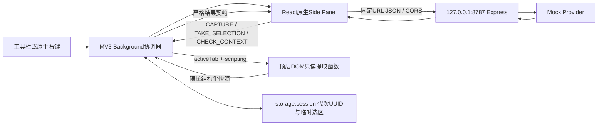

# AI 网页阅读与知识整理助手：Phase 0 技术验证最终报告

日期：2026-10-14（Asia/Shanghai）；最终收尾于15:29用户回传后。工程：`spikes/ai-browser-copilot-spike`，最终扩展版本 **0.0.2，未发布**。

## 1. 最终结论与范围

**GO：Phase 0技术可行性闸门通过。SP-01–SP-12：12 PASS / 0 FAIL / 0 BLOCKED。** 五条主路径S0-1–S0-5均有相应证据，具备后续课程研发的技术条件。本轮执行到Phase 0停止；**P1–P8尚未开始，课程/扩展发布状态均未改为已发布**。Stage 1–4、Capstone、数据库、权益和线上业务未接入或修改。

这个GO只覆盖本报告明确的Windows + Chrome155 + 本机Mock最小原型。真实模型质量、Chrome116实机兼容、完整产品与正式课程验收不属于这12项已经通过的结论。它们列为后续未测能力，不冒充本轮已验证。

输入依据保持原样：[Phase 0任务书](inputs/phase0-task.md)、[蓝图V1.1](inputs/blueprint-v1.1.md)。蓝图内的未来开发、平台迁移和发布建议仅作设计依据，未据此执行后续阶段。

### 最后两组确认的更正与重新实测

用户曾回传“两组符合预期”，随后在发现旧第二Profile配置缺少目标扩展记录时，明确说明未验证。[原确认、更正及处置](artifacts/phase0-final-20261014-151806/final-two-groups-disposition.json)、[当时只读检查](artifacts/phase0-final-20261014-151806/second-profile-readonly-check.json)全部保留；该条已撤回确认**不作为PASS依据**。

用户随后要求实际执行。代理创建了另一个[全新空Profile](artifacts/manual-final-smoke-20261014-152338/preparation.json)，提供[合并操作步骤](manual-final-smoke.md)。本次用户按该步骤再次回传“都符合预期”，记录于[原始文字](artifacts/phase0-final-20261014-152950/user-confirmation.txt)和[具体确认上下文](artifacts/phase0-final-20261014-152950/user-evidence.json)。只读核对同时确认：

- 新Profile为`.runtime/manual-profile-final-20261014-152338`，首次创建时为空、未复制旧配置；[browser root进程记录](artifacts/phase0-final-20261014-152950/final-profile-process-check.json)证明实际启动了该Profile。
- 其Secure Preferences存在扩展`hijkflihajcoealnhjnepmgabohaimcn`，指向本Spike的`.output/chrome-mv3`；manifest为0.0.2，磁盘5个运行文件与归档ZIP逐字节一致，见[最终Profile/包核对](artifacts/phase0-final-20261014-152950/final-profile-package-check.json)。
- 首次读取/Mock/右键选区、双窗口重载后的旧状态清除与功能恢复依本次**用户人工文字确认**；本次没有附两张新截图，不声称已经取得。进程、配置和hash不代替真实界面操作。

## 2. 环境、依赖与证据层级

| 项目 | 已记录值 |
|---|---|
| OS | Windows11 26H2，Build26300.9457，见[版本截图](artifacts/manual-user-20261014-133518/00-chrome-version.png) |
| Chrome实测 | 155.0.8059.41；manifest声明minimum_chrome_version=116，116本身未实测 |
| Node / npm | 24.16.0 / 11.13.0；Spike独立lockfile，package声明Node>=22 |
| 构建/界面 | WXT0.21.4 / React18.3.1 / TypeScript5.9.3 |
| 服务/契约/测试 | Express5.2.1 / Zod4.6.5 / Vitest5.0.4；esbuild0.28.2仅用于QA夹具 |
| 最终插件 | MV3，0.0.2；5个运行文件，ZIP104275 bytes |
| 模型范围 | Mock；没有调用真实模型、读取实际Key或产生模型费用 |

许可证记录见[dependency-licenses.json](artifacts/dependency-licenses.json)；既有ci审计报告0个已知漏洞，只代表当次依赖审计结果，不构成完整安全证明。

证据分为四类，并在矩阵中直接标注来源：真实Chrome人工截图；用户按具体步骤的文字确认；真实HTTP/无界面Chrome运行记录；Chrome适配器替身的确定性测试。后两类不能替代工具栏、右键、原生Side Panel的真实操作。本轮图形工具曾受限，后来由用户亲自完成；没有模拟点击、合成右键或普通扩展tab冒充原生验收。动态竞态/空闲等部分仅有文字确认，未取得连续录屏或精确Network时序；这一证据限制保持可见。

## 3. SP验收矩阵

| 编号 | 场景 | 状态 | 实际结果 | 证据 |
|---|---|---|---|---|
| SP-01 | 干净环境加载MV3 | PASS | 初始独立Profile加载截图；最终0.0.2在另一新Profile的安装配置及人工确认补齐。 | [加载截图](artifacts/manual-user-20261014-133518/01-extension-loaded.png)；[最终Profile包核对](artifacts/phase0-final-20261014-152950/final-profile-package-check.json) |
| SP-02 | 工具栏打开原生Side Panel | PASS | 真实窗口截图显示工具栏与原生侧栏；新Profile再次由用户执行。 | [原生侧栏截图](artifacts/manual-user-20261014-133518/02-toolbar-sidepanel.png)；[本次人工确认](artifacts/phase0-final-20261014-152950/user-evidence.json) |
| SP-03 | 授权后读取HTTPS网页 | PASS | 标题、URL、正文对应当前页；0.0.1读取截图与0.0.2重开/新Profile确认。 | [读取截图](artifacts/manual-user-20261014-134717/03-read-success.png)；[重开记录](artifacts/manual-user-20261014-150317/user-evidence.json) |
| SP-04 | 未授权/跨源撤权 | PASS | 新tab拒绝→点击A成功→同tab跨源后拒绝→重新授权成功。 | [四步文字确认](artifacts/manual-user-20261014-140449/user-evidence.json) |
| SP-05 | 请求中切tab/旧结果隔离 | PASS | 请求中切tab、A→B→A、同URL刷新均无旧结果恢复；重读后正常。 | [四项文字确认](artifacts/manual-user-20261014-143057/user-evidence.json)；[延迟HTTP](artifacts/manual-user-20261014-142318/delay-api-http-check.json) |
| SP-06 | 两个HTTPS站点右键划词 | PASS | Example与IANA选区正确，URL及不同tabId各自对应。 | [Example截图](artifacts/manual-user-20261014-141247/06-selection-example.png)；[IANA截图](artifacts/manual-user-20261014-141247/06-selection-iana.png) |
| SP-07 | 空/长/过期/失效选区 | PASS | 一次消费、65秒、空覆盖、切tab/刷新/关闭来源、超长拒绝与无关后台tab隔离通过。 | [一次消费截图](artifacts/manual-user-20261014-141247/07-consumed-example.png)；[有效期记录](artifacts/manual-user-20261014-141951/user-evidence.json)；[边界记录](artifacts/manual-user-20261014-142318/user-evidence.json) |
| SP-08 | 侧栏Mock真实往返 | PASS | 用户明确确认摘要成功；正常Network fetch200/preflight204；重启后仍可用。 | [Mock文字确认](artifacts/manual-user-20261014-140054/user-evidence.json)；[Network截图](artifacts/manual-user-20261014-144851/09-network-no-throttling-baseline.png) |
| SP-09 | API故障提示/重试/恢复 | PASS | 504、502、断服务Failed to fetch、客户端超时均反馈且按钮恢复；普通服务/取消限速后成功。 | [504截图](artifacts/manual-user-20261014-143413/09-server-timeout-504.png)；[502截图](artifacts/manual-user-20261014-143754/09-invalid-provider-502.png)；[超时恢复确认](artifacts/manual-user-20261014-145526/user-evidence.json) |
| SP-10 | manifest与打包审查 | PASS | 5个必要权限、无host_permissions/常驻content_scripts/popup；包中无.env/API源文件，启发式密钥扫描无命中；5个运行文件一致。 | [包审查](artifacts/worker-lifecycle-fix/package-audit.json)；[最终逐文件核对](artifacts/phase0-final-20261014-152950/final-profile-package-check.json) |
| SP-11 | 内部页/禁止注入页 | PASS | chrome://version、新标签页、Web Store拒绝；普通页恢复，无旧正文/摘要。 | [四步文字确认](artifacts/manual-user-20261014-140901/user-evidence.json) |
| SP-12 | 重开/空闲/重载/干净Profile | PASS | 完整退出和重开已核验，空闲可用；本次新Profile安装来源与实际操作补齐重载和第二环境。 | [退出进程](artifacts/manual-user-20261014-145920/profile-exit-process-check.json)；[空闲确认](artifacts/manual-user-20261014-150910/user-evidence.json)；[本次确认](artifacts/phase0-final-20261014-152950/user-evidence.json)；[新Profile进程](artifacts/phase0-final-20261014-152950/final-profile-process-check.json) |

[当前人工验收记录](manual-acceptance-record.md)和[结构化最终矩阵](artifacts/phase0-final-20261014-152950/acceptance-matrix.json)与此表一致。旧版实际失败、修复前测试及曾经的BLOCKED均保留在原始日志与[收尾前完整历史](artifacts/phase0-final-20261014-152950/before-final-evidence.md)，没有用当前PASS覆盖历史事实。

### 五条主路径归属

| 主路径 | 状态 | 结论 |
|---|---|---|
| S0-1 WXT/MV3加载与侧栏 | PASS | 有版本、构建、真实侧栏截图；完整退出重开与重载后恢复也由用户验证 |
| S0-2 临时授权与正文读取 | PASS | 普通action授权后注入成功；无授权/跨源/受限页安全拒绝，无全站权限 |
| S0-3 原生划词与消息 | PASS | 两个HTTPS站点、同窗口不同tab来源正确；边界、一次消费与失效通过 |
| S0-4 本地模型代理 | PASS（Mock） | 真实侧栏网络往返和故障/超时/重试/恢复通过；真模型未测 |
| S0-5 干净重建与打包 | PASS | 新目录ci/types/test/build/zip通过；本次新Profile加载同一0.0.2并完成真实链路 |

## 4. 非图形验证与可复现交付

| 验证 | 状态 | 证据及适用范围 |
|---|---|---|
| 干净新目录安装/类型检查/测试/构建/ZIP | PASS | [环境与重建目录](artifacts/worker-lifecycle-fix/rebuild/rebuild-environment.txt)、[ci](artifacts/worker-lifecycle-fix/rebuild/rebuild-ci.txt)、[类型检查](artifacts/worker-lifecycle-fix/rebuild/rebuild-typecheck.txt)、[测试](artifacts/worker-lifecycle-fix/rebuild/rebuild-test.txt)、[build](artifacts/worker-lifecycle-fix/rebuild/rebuild-build.txt)、[zip](artifacts/worker-lifecycle-fix/rebuild/rebuild-zip.txt) |
| 自动测试 | PASS | [最终日志](artifacts/worker-lifecycle-fix/test.txt)：5文件44项通过；涵盖真实HTTP/API客户端与确定性协调器/生命周期/toolbar测试，不将重复日志相加 |
| 无host权限的实际Chrome网络/无grant负例/受控DOM | PASS | [Chrome probe](artifacts/round2/chrome-verified/chrome-network-probe.json)：真实worker与普通扩展文档；只用于对应能力，不冒充原生侧栏 |
| 实际worker终止/唤醒 | PASS（独立夹具） | [before/after生命周期记录](artifacts/worker-lifecycle-fix/chrome-lifecycle-probe.json)：真实Chrome worker/storage.session，tab与scripting为固定适配器 |
| HTTP延迟、504、502与断服务 | PASS | [延迟](artifacts/manual-user-20261014-142318/delay-api-http-check.json)、[504](artifacts/manual-user-20261014-143057/timeout-api-http-check.json)、[502](artifacts/manual-user-20261014-143413/invalid-provider-http-check.json)、[断服务](artifacts/manual-user-20261014-143902/offline-api-check.json)、[恢复](artifacts/manual-user-20261014-144122/normal-mock-recovery-http-check.json)；另有对应用户UI结果 |
| 包/当前源码一致性 | PASS（注明例外） | [源码与重建核对](artifacts/phase0-final-20261014-151806/source-vs-tested-rebuild.json)及[解释](artifacts/phase0-final-20261014-151806/delivery-consistency-review.json)：34文件一致；唯一差异为QA生命周期脚本把固定证据目录改为新时间戳/EVIDENCE_DIR，不改验证逻辑。产品、契约、API、测试与已通过重建相同 |
| 最终磁盘包 | PASS | [包审查](artifacts/worker-lifecycle-fix/package-audit.json)及[本次新Profile目录逐文件核对](artifacts/phase0-final-20261014-152950/final-profile-package-check.json)；未在最终文档整理时覆盖构建产物 |

干净重建采用新的空目录，保留旧产物与Profile，等价完成无依赖/无旧产物的重建条件；遵守用户禁止批量删除的约束。当前交付ZIP：

[ai-browser-copilot-phase0-0.0.2-chrome.zip](artifacts/worker-lifecycle-fix/ai-browser-copilot-phase0-0.0.2-chrome.zip)

```text
SHA256 c42d91517699e4d4335c3c8bc8330e227a987d48ee7551026c45d9b8b18f6bab
```

## 5. 最终技术架构



### 扩展职责与授权

保留WXT/React/TypeScript/Express路线与原Spike。没有常驻Content Script；Phase0通过`chrome.scripting.executeScript`按需注入只读函数，验证“网页执行上下文→Background→Panel”的内容读取通路。该函数不携带Key、不请求模型、不接受网页任意命令，阶段内无需提前实现完整Content Script产品能力。

- 工具栏显式`openPanelOnActionClick:false`，普通`chrome.action.onClicked`原生回调中同步`sidePanel.open`。Panel内部按钮只复用仍有效的activeTab，不产生新grant。
- 正文上限6000字符，选区上限2000字符；只读顶层可见文本，受控fixture排除隐藏、表单值及导航。标题/URL/页面文字均是不可信数据，作为文本处理。
- runtime只接受本扩展精确sidepanel.html来源、拒绝sender.tab和格式不符消息。请求ID、snapshotId、tabId/URL及contextToken用于匹配，CHECK_CONTEXT在API前后复核，generation/Abort使旧异步结果丢弃。
- contextToken是匿名页面代次UUID，storage.session使普通worker重建恢复未变页面代次；真正加载/URL变化/相关tab激活使旧上下文失效。它不承担用户鉴权。
- 选区按window串行存取、最新事件覆盖、一次消费。age<0或>=60000ms拒绝，空/长/子框架来源不复用历史选区；无关后台tab变化不清除当前有效选区。
- session中包含临时选区文字及来源，页面快照/摘要在Panel内存中。60秒是使用有效期；未消费文字可能留在session直至覆盖、清除或会话结束，不声称定时物理删除或已实现持久笔记。

### 本地API最小权限与边界

**当前实测Chrome155 + 本API精确CORS配置，新增host权限为0。** manifest只含activeTab、scripting、sidePanel、contextMenus、storage，无host_permissions、全站matches、popup或常驻content_scripts。

实际网络来自扩展Origin，API只放行`chrome-extension://hijkflihajcoealnhjnepmgabohaimcn`，拒绝错误Origin/Host。CSP `connect-src`固定`http://127.0.0.1:8787`，fetch固定summary URL、redirect:error、credentials:omit。CSP限制目的地，activeTab授予网页临时读取，CORS控制普通跨源响应；这些机制职责不同。

Express只绑定127.0.0.1；限制POST/JSON、预检方法/header、64KiB body、6000正文、30次/分钟，校验schema和Provider输出/ID；服务端1.8秒超时，Panel客户端2.5秒超时，断连向Provider传取消信号。502夹具验证的是**服务端拒绝非法Provider输出后返回502**，不是侧栏收到裸非法JSON；裸非法JSON/ID错配/重定向另由实际HTTP客户端测试覆盖。

Origin和回环地址不是公网用户鉴权，也不能阻止恶意本地进程伪造header。本轮只Mock且不公开部署；当前SummaryResponse的provider固定mock。未来接真实Provider须明确修改共享契约与适配器，不能宣称原型可无改动切换真实模型。

## 6. 已发现问题、调查与修复

| 问题 | 调查与修复 | 最终结果 |
|---|---|---|
| 0.0.0自动侧栏打开但无activeTab | [用户失败截图](artifacts/toolbar-grant-fix/03-read-permission-denied-full-window.png)与[同版Chromium源码取证](artifacts/toolbar-grant-fix/chromium-source-evidence.json)定位自动Side Panel action在grant前返回；改普通action回调同步打开并覆盖旧持久设置 | 0.0.1原生读取截图PASS，0.0.2完整路径继续PASS；未扩权 |
| 0.0.1空闲后TAB_CHANGED误失效 | [修复前回归失败](artifacts/worker-lifecycle-fix/reproduction-before-fix.txt)定位内存代次随worker丢失；改session UUID，导航同步失效与串行写入，存储失败保守拒绝 | 0.0.2生命周期对照、44项测试及用户45/65秒继续调用PASS |
| 仅tabId/URL漏同URL刷新和A→B→A | 导航代次、API前后CHECK_CONTEXT、异步完成后generation复核及取消 | 确定性测试及真实人工竞态确认PASS |
| 选区重复消费、TTL起点和后台tab干扰 | per-window队列、事件开始计时、未来时间拒绝、相关上下文清除与最新事件胜出 | 自动边界测试及人工空/长/过期/切页/关闭/后台隔离PASS |
| API预检/方法/类型/输出校验不完整 | 收紧Host/Origin/POST/JSON/schema与响应ID，限制超时、重定向与凭据 | 真实HTTP错误链及人工504/502/断连/客户端超时恢复PASS |
| 测试工具制造伪失败/重复计数 | 调查tsx `__name`注入辅助错误，探针只接受真实权限拒绝；Vitest排除.runtime旧副本；QA证据目录改为新增路径 | 修正后的Chrome证据与最终44项计数保留；不将错误探针当产品失败 |

旧0.0.0、0.0.1包、失败输出、第一轮报告、收尾期间每次更新前快照和本次撤回记录均保留。最终0个FAIL指当前必测矩阵没有未解决缺陷，不表示历史从未失败。

## 7. 剩余风险与未测能力

以下是能力边界与后续风险，**不计入已完成的12项Phase0矩阵**：

| 项目 | 状态 | 影响与处理 |
|---|---|---|
| Chrome116实际兼容/其他版本与企业策略 | BLOCKED（未实测） | 当前只承诺155实测结果；冻结正式教材支持范围前补受控环境验证，不能由manifest下限推导全版本通过 |
| 真模型、结构化输出质量、费用/提示注入评估 | BLOCKED（未授权、未测） | Mock只证明通路；后续P3/P5另行实现Provider契约、服务端Key边界及质量/拒答/引用评估 |
| iframe人工可选项、复杂SPA/Shadow DOM/PDF/登录墙 | BLOCKED（未实测/原型范围外） | 当前只顶层只读提取；按后续正式验收范围逐项补充，不能把普通页成功推广到所有网页 |
| 极端事件时序和跨版本生命周期 | 已有覆盖，仍有残余风险 | 有确定性测试、真实worker夹具与人工竞态确认，但无穷尽性；正式Reference保留回归与关键操作录屏证据 |
| 公开部署本地演示API | 未实施 | 公开服务必须新增真正鉴权/额度/滥用防护；当前保持回环Mock，不将Origin当账号授权 |
| 隐私与后续笔记持久化 | 未实施 | 当前session临时选区不是持久笔记；后续明确保留期/删除/导出、存储预算与权限边界 |

## 8. 对蓝图V1.1的必要调整建议

详见[Phase0蓝图调整建议](blueprint-adjustments-phase0.md)。本轮仅写建议，没有改蓝图原件或开发P1–P8。

1. P1明确普通action回调打开Side Panel与自动侧栏行为差异，保留真实图标验收；版本清单采用实测值与lockfile。
2. P2/共享PageSnapshot加入独立页面代次和异步归属规则，保留未来blocks/blockId设计，不能只比较tabId/URL；worker内存不承担跨休眠状态。
3. P3分别讲清activeTab、CORS、host权限与CSP；当前本地API无需新增host权限。引入真实Provider时同步调整固定mock的响应判别字段与测试，Key只放服务端。
4. P4固定window/tab/URL/代次、60秒有效期、2000字符和一次消费语义，区分有效期与实际存储清除时点。
5. P8把干净重建、原生工具栏/右键、无DevTools空闲、重载及独立Profile纳入分层证据；PASS注明截图/文字/HTTP/替身范围，保留失败和更正。
6. 继续沿用平台项目维度与权益隔离，正式课/Capstone/进度统计/发布闸门保持原边界。真实模型质量、引用和完整产品T01–T36仍属未来授权阶段。

## 9. 交付、Git及停止位置

保留原工程、lockfile、最小fixtures、独立Mock API、[架构决策](decisions.md)、[Windows人工指南](manual-chrome-acceptance.md)、[最后合并操作](manual-final-smoke.md)、[完整验收记录](manual-acceptance-record.md)及所有原始证据。最终文件与hash索引见[证据清单](artifacts/phase0-final-20261014-152950/evidence-index.json)。

本机main分支，基础HEAD `d5cb93798e9293fe95033ba92755b7090a3e548f`，未创建commit、暂存、推送或部署。平台已有14个被跟踪文件的未提交修改不是本Spike变更；本轮最终整理前后hash核对见[受保护工作区检查](artifacts/phase0-final-20261014-152950/protected-worktree-check.json)。最终代码/测试/文档变更均限此Spike；未运行数据库迁移/seed、主站构建或课程发布操作，没有批量/递归删除。

交接时普通Mock仍在127.0.0.1:8787运行供复看，8001测试fixture已停止，见[运行状态](artifacts/phase0-final-20261014-152950/runtime-at-handoff.json)；没有安排后续自动任务。依据任务书GO标准，关键项均已通过，**具备进入后续研发的技术条件；本轮工作在Phase0报告完成处停止，未进入P1–P8、未发布。**
